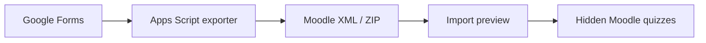

# Moodle Importer

**Google Forms → Moodle XML → ready-to-use Moodle quizzes.**

[Русская версия](README.ru.md) · [Setup guide](docs/setup.md)

A two-part migration tool: a Google Apps Script exporter reads Google Forms,
then a Moodle local plugin imports XML files or ZIP packages as hidden quiz activities.
This removes the separate step of assembling each quiz from the question bank.

## Features

- Export individual forms or a folder, with resumable scheduled batches and status reports.
- Convert single/multiple choice, short answers, essays and descriptions; embed supported images.
- Package exported XML into bounded ZIP archives.
- Preview imports, choose a course/section, and create quizzes hidden from students.
- Preserve question order and marks; skip repeat imports in the same course.
- Validate XML/media and ZIP paths; isolate quiz creation in per-quiz transactions.



## Quick start

1. Install `moodle/local/formsquiz` into a **Moodle 4.3.x** instance as `local/formsquiz`.
2. Create an Apps Script project from the two files in `exporter/`.
3. Configure access and `SOURCE_FOLDER_ID`, then run `startFolderExport`.
4. Inspect the export reports and run `buildMoodlePackages` when the export has finished.
5. Upload XML/ZIP at `/local/formsquiz/index.php`, review the preview, then create hidden quizzes.
6. Preview the resulting quizzes before making them visible to learners.

See [the setup guide](docs/setup.md) for API configuration, manual export and limits.

## Repository

| Path | Purpose |
| --- | --- |
| `exporter/` | Google Apps Script source and manifest |
| `moodle/local/formsquiz/` | Moodle plugin 0.3.0 |
| `moodle/local/formsquiz/tests/` | Moodle PHPUnit tests and synthetic XML fixture |
| `docs/` | Installation and operation |

## Compatibility and limitations

The plugin declares Moodle 4.3 support. Other versions have not been verified in this publication.
Supported XML question types are `multichoice`, `shortanswer`, `essay` and `description`.
Google Forms branching, participant responses and quiz settings are not migrated.
Unsupported fields and questions require review of the export report. A completed queue can still contain failed forms.

Import limits: 100 resolved XML files, 25 MiB per XML and 100 MiB total; the server may impose smaller limits.
Repeated imports do not update earlier quizzes or their attempts.

## Tests

Inside a configured Moodle checkout with the plugin installed:

```sh
vendor/bin/phpunit local/formsquiz/tests/importer_test.php
```

These are Moodle integration tests; they require Moodle's test database and PHPUnit setup.

## Data and licensing

This repository contains source and synthetic test data. Exported forms, responses, reports,
credentials and real Drive IDs are excluded. Exports can contain private question content;
store them outside this repository.

The Moodle plugin is licensed under **GPL-3.0-or-later**, as stated in its source and
[license](moodle/local/formsquiz/LICENSE.txt). No additional license grant is made here for the exporter.

## Local regression checks

The exporter checks use mocked Apps Script services and synthetic data. Node.js is required.
They do not call Google services.

```sh
node tests/export-conversion.cjs
node tests/export-queue.cjs
node tests/export-packages.cjs
php tests/xml-inspector.php
```

The standalone XML check requires PHP with DOM, mbstring and image inspection support.
